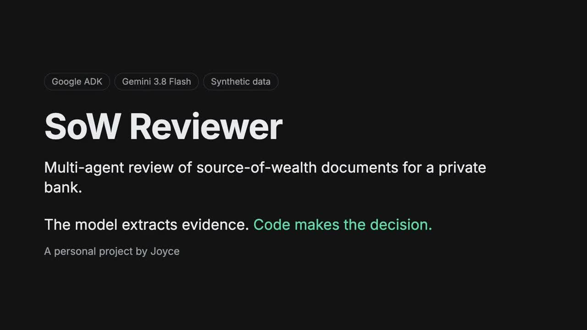
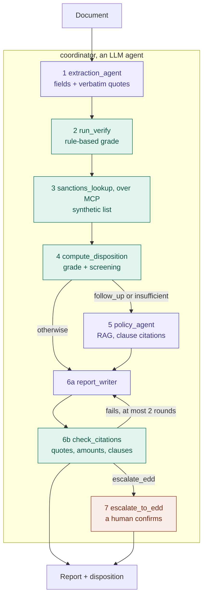

# SoW Reviewer

A multi-agent system that reviews source-of-wealth (SoW) documents, built on Google ADK and Gemini. I built it while applying for Google Cloud's Forward Deployed Engineer role. It's a personal project and every document in it is synthetic. Design notes are in `docs/`.

## Demo

[](docs/demo.mp4)

Three minutes: [docs/demo.mp4](docs/demo.mp4). I recorded it from local `adk web` runs of sow-010 and sow-008 on 2026-11-03. The voiceover is AI-generated.

## How it works

Give it one SoW document pack and it decides whether the stated source of wealth is evidenced, needs follow-up, or should go to Enhanced Due Diligence (EDD). An EDD escalation waits for a human to confirm it.

The rule I held to: the model pulls out evidence, and deterministic code makes the call. Every extracted field comes with a verbatim quote, so a reviewer can check any conclusion against the document.



Purple boxes are model calls, green is plain code, orange is a person. The coordinator follows the step order in its prompt. If it skips verification or screening, the code in step 4 refuses to return a disposition.

Where the code decides:

| Code | Where | What it does |
|---|---|---|
| `verify()` | `sow_reviewer/verify.py` | Required fields need a quote. A flagged issue, an unexplained credit of 50,000 or more, or a gift of 100,000 or more means follow-up. A missing field means insufficient. |
| salary total | `sow_reviewer/schemas.py` | Adds up salary components (monthly × 12 + annual), so the model never does arithmetic. |
| `sanctions_lookup` | `tools/sanctions_server.py` | Exact primary name scores 1.0, exact alias 0.9, every word of a listed name present 0.7. |
| `compute_disposition` | `sow_reviewer/review_tools.py` | Any sanctions match escalates. Won't answer without a verification and a screening, or after a failed lookup. |
| `check_citations` | `sow_reviewer/citations.py` | Quotes must appear in the document, amounts in a source, clauses in the policy answer. `approve_report` refuses until it passes. |
| `require_confirmation` | `sow_reviewer/agent.py` | ADK pauses before escalation until a human approves. |

Three cases cover the three outcomes:

| Case | What happens | Disposition |
|---|---|---|
| sow-004 salary letter | Code adds up SGD 300,100 from four components; no issue, no match | `evidenced` |
| sow-008 gift letter | SGD 100,000 gift, donor's source of funds not stated; the policy step cites SOW-POL 4.1 and 4.2 | `follow_up` |
| sow-010 salary letter | The document is clean, but the client's name matches a listed alias (score 0.9) | `escalate_edd`, paused for a human |

## Results

From runs on 2026-11-02 and 2026-11-03 with `gemini-3.8-flash` through Google Cloud. `outputs/` isn't committed, so I copied the numbers here.

| Check | Result | How |
|---|---|---|
| Unit tests | 104 passed | `uv run --extra gcp --extra eval pytest`, no model calls |
| End-to-end disposition | 10/10, 0 errors | `scripts/metrics.py`, local, RAG on |
| Critic approved the report | 10/10 | same run |
| `adk eval` | 10 passed, 0 failed | `evals/sow_golden.evalset.json`, tool trajectory and `disposition_match` |
| Extraction grade | 10/10 | `scripts/extract_all.py`, then `scripts/run_evals.py` |
| Extraction fields | 80/80 | same |
| Planted issues flagged | 6/6 | same |
| Sanctions screening | 10/10 | same; sow-010 matches, the other nine don't |
| Model cost per case | US$0.041 mean | estimate, see below |
| Latency | p50 208 s, p95 1,011 s | `metrics.py`, not counting time spent waiting for a human |

Some caveats. The first extraction run scored 7/10 on grade and 80/81 on fields. I then changed the spec, the expected answers and the code while looking at those errors, so these scores come from cases the system was tuned on. There's no held-out set yet.

The cost is token counts times the list prices in `config/pricing.json` (read 2026-11-02), not a billed amount: 319,069 tokens over 10 cases. I think the long p95 is mostly rate limiting, since 429 retries show up in the logs, but I didn't check it case by case.

I also deployed it to Agent Runtime in `us-central1` and ran three cases there. sow-004 came back `evidenced` in 112 s, sow-008 `follow_up` citing SOW-POL 4.1 and 4.2 in about 154 s, and sow-010 `escalate_edd`, paused for approval, in 58 s. I deleted the runtime on 2026-11-03 to stop billing; `scripts/deploy.sh` brings it back. The RAG corpus is still there for local runs.

## Run locally

It runs in Google Cloud mode with Application Default Credentials. `sow_reviewer/.env` sets `GOOGLE_GENAI_USE_ENTERPRISE=1`, `GOOGLE_CLOUD_PROJECT`, `GOOGLE_CLOUD_LOCATION=global` and, for the policy step, `RAG_CORPUS`. Pass `--extra gcp` to every `uv` command. Without it, uv removes the RAG and deploy dependencies.

```bash
gcloud auth application-default login
cp .env.example sow_reviewer/.env               # then fill in the values above
uv sync --extra gcp --extra eval
uv run --extra gcp adk web .                    # browser UI; paste a document from data/cases/
uv run --extra gcp python scripts/metrics.py    # end to end on all 10 cases
uv run --extra gcp pytest
```

## Deploy

Models go through `GOOGLE_CLOUD_LOCATION=global` because `gemini-3.8-flash` isn't served from `us-central1`. The corpus and the runtime live in `us-central1`, the only region with RAG Engine Serverless mode, so there's no dedicated Spanner instance to keep paying for.

```bash
export GOOGLE_CLOUD_PROJECT=your-project GOOGLE_CLOUD_LOCATION=us-central1
uv run --extra gcp python scripts/setup_rag.py     # put the printed RAG_CORPUS in sow_reviewer/.env
scripts/deploy.sh
uv run --extra gcp python scripts/smoke_test.py <reasoningEngine resource> sow-004
uv run --extra gcp python scripts/teardown.py <reasoningEngine resource> [<ragCorpus resource>]
```

One thing only broke after deploying: the runtime's service agent needs `aiplatform.ragCorpora.query`, which comes with `roles/aiplatform.user`.

```bash
gcloud projects add-iam-policy-binding your-project \
  --member="serviceAccount:service-PROJECT_NUMBER@gcp-sa-aiplatform-re.iam.gserviceaccount.com" \
  --role=roles/aiplatform.user --condition=None
```

## Layout

| Path | What |
|---|---|
| `sow_reviewer/agent.py` | ADK agents (`root_agent` for the CLI) |
| `sow_reviewer/schemas.py` | Pydantic output schema |
| `sow_reviewer/verify.py` | deterministic verification rules |
| `tools/sanctions_server.py` | MCP server over a synthetic list |
| `data/cases/` | 10 synthetic documents |
| `data/expected/` | ground truth per case |
| `data/field_spec.md` | what to extract; it's part of the extraction prompt |
| `data/cases/PLANTED_ISSUES.md` | the planted issue per case; kept out of the prompt |
| `docs/verify_rules.md` | rule table for `verify()` and the MCP tool spec |
| `scripts/extract_all.py` | batch extraction with latency and token counts |

## Boundaries

All documents, names, companies and list entries are fictional. Nothing here comes from any employer's code, specifications or client material.
