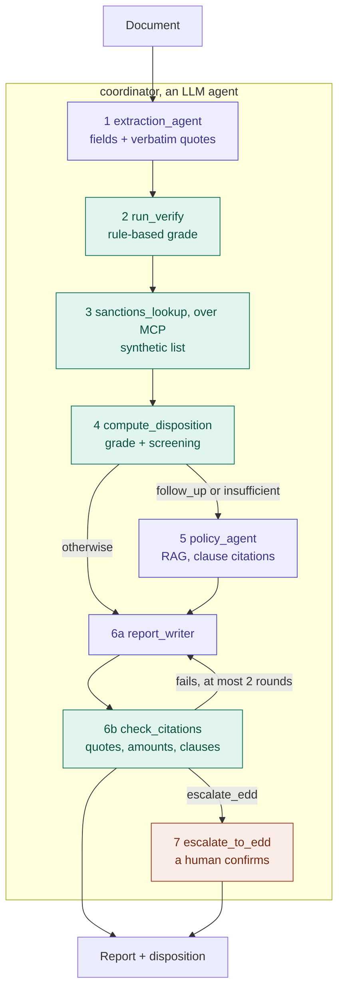

# SoW Reviewer

Multi-agent **source-of-wealth document review** built on Google ADK + Gemini. Personal project, synthetic data only. Written for a Google Cloud FDE application; see `docs/` for design notes.

**Status (2026-11-02):** all 10 synthetic cases pass end to end and in `adk eval` on `gemini-3.8-flash` through Google Cloud, run locally with RAG Engine answering policy questions with clause citations. The agent is deployed to Agent Runtime in `us-central1`, where three cases have been run and passed: sow-004, sow-008 (with the policy step) and sow-010 (pauses for human confirmation).

These scores come from cases the rules and spec were tuned against. There is no held-out set.

## What it does

A coordinator agent reviews one SoW document pack and decides whether the stated source of wealth is evidenced, needs follow-up, or should be escalated to Enhanced Due Diligence (EDD), with a human confirming the escalation.



Purple is a model, green is deterministic code, orange is a human. The coordinator calls the steps in the order its prompt gives; the code checks in step 4 refuse a disposition if verification or screening is missing.

Design principle: **the model extracts evidence, deterministic rules decide.** Every field in the extraction carries a verbatim quote, so a reviewer can trace each conclusion back to the document.

| Code | Where | What it does |
|---|---|---|
| `verify()` | `sow_reviewer/verify.py` | Required fields need a quote. A flagged issue, an unexplained credit of 50,000 or more, or a gift of 100,000 or more means follow-up. A missing field means insufficient. |
| salary total | `sow_reviewer/schemas.py` | Sums salary components (monthly × 12 + annual), so the model never does arithmetic. |
| `sanctions_lookup` | `tools/sanctions_server.py` | Exact primary name 1.0, exact alias 0.9, every word of a listed name present 0.7. |
| `compute_disposition` | `sow_reviewer/review_tools.py` | Any sanctions match escalates. Refuses to answer without a verification, a screening, or after a failed lookup. |
| `check_citations` | `sow_reviewer/citations.py` | Quotes must appear in the document, amounts in a source, clauses in the policy answer. `approve_report` refuses until it passes. |
| `require_confirmation` | `sow_reviewer/agent.py` | ADK pauses before escalation until a human approves. |

Three cases show the three endings:

| Case | What happens | Disposition |
|---|---|---|
| sow-004 salary letter | Code sums SGD 300,100 from four components; no issue, no match | `evidenced` |
| sow-008 gift letter | SGD 100,000 gift, donor's source of funds not stated; policy step cites SOW-POL 4.1 and 4.2 | `follow_up` |
| sow-010 salary letter | Clean document, but the client's name matches a listed alias (score 0.9) | `escalate_edd`, paused for a human |

## Run locally

```bash
cp .env.example sow_reviewer/.env   # put your AI Studio key in GOOGLE_API_KEY
cp .env.example .env
uv sync
uv run adk run sow_reviewer                # chat: paste a document from data/cases/
uv run adk web .                           # browser UI
uv run python scripts/extract_all.py       # extract all 10 cases → outputs/extracted/
uv run pytest
```

## Deploy

Models run through `GOOGLE_CLOUD_LOCATION=global`, because `gemini-3.8-flash` is not served from `us-central1`. The corpus and the runtime are in `us-central1`, the only region for RAG Engine Serverless mode, which has no dedicated Spanner instance to keep paying for.

```bash
export GOOGLE_CLOUD_PROJECT=your-project GOOGLE_CLOUD_LOCATION=us-central1
uv run --extra gcp python scripts/setup_rag.py     # put the printed RAG_CORPUS in sow_reviewer/.env
scripts/deploy.sh
uv run --extra gcp python scripts/smoke_test.py <reasoningEngine resource> sow-004
uv run --extra gcp python scripts/teardown.py <reasoningEngine resource> <ragCorpus resource>
```

The runtime service agent also needs `aiplatform.ragCorpora.query`, which `roles/aiplatform.user` includes:

```bash
gcloud projects add-iam-policy-binding your-project \
  --member="serviceAccount:service-PROJECT_NUMBER@gcp-sa-aiplatform-re.iam.gserviceaccount.com" \
  --role=roles/aiplatform.user --condition=None
```

## Layout

| Path | What |
|---|---|
| `sow_reviewer/agent.py` | ADK agents (`root_agent` for the CLI) |
| `sow_reviewer/schemas.py` | Pydantic output schema |
| `sow_reviewer/verify.py` | deterministic verification rules |
| `tools/sanctions_server.py` | MCP server over a synthetic list |
| `data/cases/` | 10 synthetic documents |
| `data/expected/` | ground truth per case |
| `data/field_spec.md` | what to extract; it is part of the extraction prompt |
| `data/cases/PLANTED_ISSUES.md` | the planted issue per case; kept out of the prompt |
| `docs/verify_rules.md` | rule table for `verify()` and the MCP tool spec |
| `scripts/extract_all.py` | batch extraction with latency and token counts |

## Schedule

| Day | Deliverable |
|---|---|
| 10-26 | GCP project, `adk` installed, template runs |
| 10-27 | 5 synthetic cases + field spec |
| 10-28 | extraction agent, 5 JSON outputs |
| 10-29 | `verify()` + `sanctions_lookup`, unit tests |
| 10-30 | policy corpus → RAG Engine, retrieval sub-agent |
| 10-31 | coordinator + critic loop + human confirmation + `adk eval` on 10 golden cases |
| 11-01 | tracing, p50/p95 and cost per case, deploy to Agent Runtime, demo |

## Boundaries

All documents, names, companies and list entries are fictional. Nothing here is derived from any employer's code, specifications or client material.
